# 理论基础

## 数理逻辑

## ==？==

## 计算理论

### 复杂度分析方法

- 记号
- 调和级数
- 主定理
- 均摊复杂度

# 语言基础

## 函数与标识符

## 变量与类型

## 运算与表达式

### 位运算

#### gcc 相关内建函数

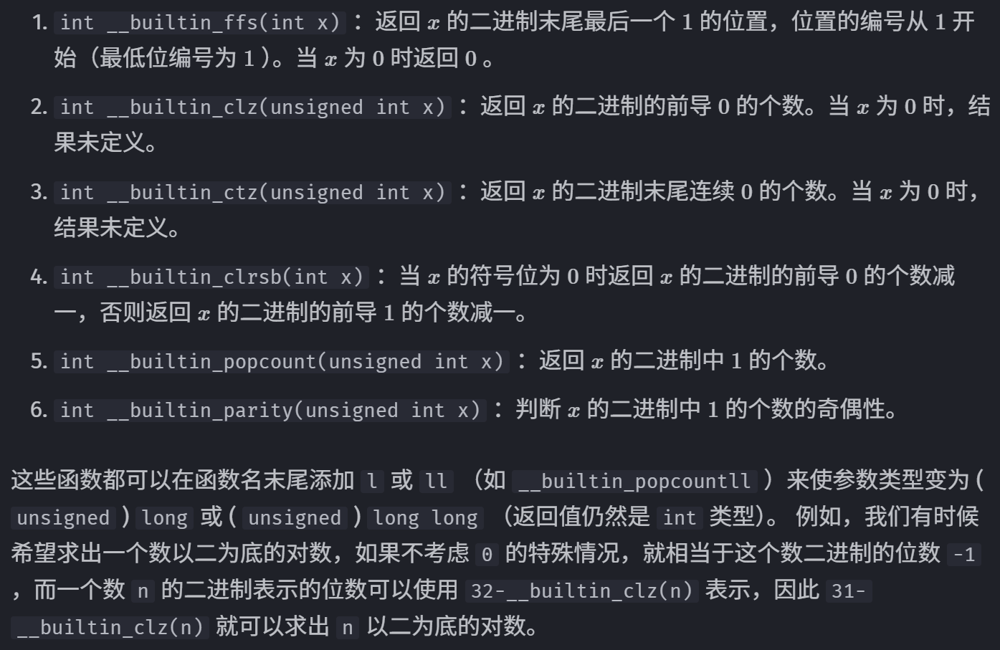

#### 更多位数的 `bitset`

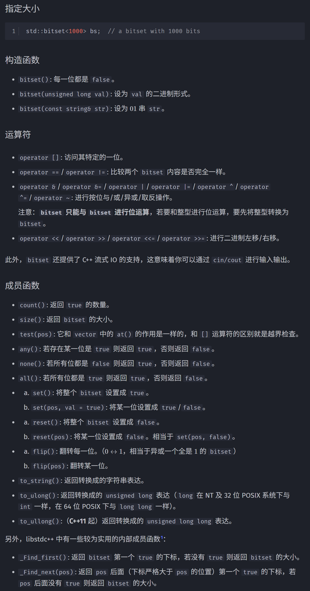

## 结构体和封装

# 基础算法

## 排序

## 高精度

## 模拟

## 枚举

## 递归

## 迭代

## 递推

## 贪心

## 二分

### 二分查找

二分查找适用于对单调序列的元素或连续单调函数函数值点的查找.

对于单调序列 $\{a_i\}_n$ 的元素查找，要解决的是如下问题：

- 给定 $x$，求 $i|a_i=x$
- 给定 $x$，求 $\{i|a_i=x\}$ 的最值
- 给定 $x$，分别求 $\{i|a_i\geq x\}$、$\{i|a_i<x\}$（或 $\{i|a_i>x\}$、$\{i|a_i\leq x\}$）的最小、最大值

其中单调序列侧重讨论后两个问题，并且显然只要讨论给定 $x$，求 $\{i|a_i\geq x\}=:A$ 的最小值便具有一般意义.

考虑迭代，逐步从 $[1, n]$ 开始缩小所求所在的范围. 假设某次迭代中，确定的所求 $i$ 的范围为 $[l,r]$，为了下一次迭代，我们考察中点 $m=\lfloor\frac{l+r}{2}\rfloor$：

- 如果 $m\not\in A$，范围显然可缩小为 $[m+1,r]$
- 如果 $m\in A$，范围显然可缩小为 $[l,m]$，但为了能够达到迭代终点，我们将下一次的迭代范围缩小至 $[l,m-1]$，对于一个可能的答案 $m$，我们单独记下来，显然这样的 $m$ 至多只需要持有最新的一个

迭代终点是 $l>r$ 时，答案就是目前持有的 $m$. 特别地，$A$ 是空集时不会有任何 $m$ 被记录下来.

复杂度 $O(\log n)$. 模板如下：

```cpp
int fnd(int x, int a[], int l, int r) // 从 [l, r] 开始迭代
{
    int m, res = -1; // -1 表示找不到
    while (l <= r) {
        m = l + (r - l) >> 1; // 防止溢出
        if (a[m] < x) {
            l = m + 1;
        } else {
            res = m;
            r = m - 1;
        }
    }
    return res;
}
```

对于连续单调函数 $f(x)$ 函数值点的查找，讨论类似. 迭代终点取决于问题对函数值点的精度有要求还是对函数值的精度有要求，并且，由于不持有中间的可能答案，所以答案不存在的情况需要特别讨论.

不过，相较于单调序列侧重讨论“界”，连续的单调函数侧重讨论“值”，即给定 $y$，求 $x|f(x)=y$. 类似地，模板如下：

```cpp
double fnd(int y, double (*f)(double), double l, double r)
{
    if ((f(l) > y + epsilon || f(r) < y - epsilon) && 
        (f(l - delta) > y || f(r + delta) < y)) return NAN; // 答案不存在 
    double m;
    while (r - l > delta) { // delta 是函数值点的精度要求
        m = (l + r) / 2;
        auto t = f(m);
        if (abs(t - y) < epsilon) { // epsilon 是对函数值的精度要求
            return m;
        } else if (t > y) {
            r = m;
        } else if (t < y) {
            l = m;
        }
    }
    return l;
}
```

复杂度 $O(\min\{\log\frac{D}\delta,\log\frac{I}\varepsilon\})$，其中 $D$ 为函数定义域的长度，$I$ 为函数值域的长度，$\delta$ 是问题对函数值点的精度要求，$\varepsilon$ 是问题对函数值的精度要求.

### 二分答案

有一些问题，它的答案 $a$ 显然地在集合 $A$ 中取值；如果 $A$ 是有序的，并且存在一种快速的方法，能够检验某一待定答案与问题的真答案间的偏序关系，那么就可以进行二分答案求解这些问题. 这是显然的，因为存在一个 $A$ 上的单调减函数 $F:A\to\{0,1\}$， $F(x)=[x\leq a]$，我们只需求解 $\max\{x\in A|[x\leq a]即F(x)=1\}$.

复杂度 $O(f\log|A|)$，其中 $f$ 为求解 $F$ 的复杂度.

### 最值最值化问题

最值最值化问题，包括最大值最小化问题和最小值最大化问题；最小值最大化问题是指求解某一系统的一系列属性中的最小值在所有可能的情况下最大是多少，形式化地说，就是对于情况域 $P$ 上的集合值函数 $A(p)$，求 $\max_{p\in P}\min A(p)$，最大值最小化问题描述类似.

记 $M:=\{\min A(p)|p\in P\}$，则 $m:=\max M$ 即为所求.

所求的上下界通常是容易确定的. 如果我们再能找到一种快速的方法，能够通过尝试构造等方式在给定待定答案 $x$ 的时候判断存不存在一种情况 $p$，能使得 $\min A(p)\geq x$，那么就可以适用二分答案. 这是显然的，因为 $\exist p\in P,\min A(p)\geq x\lrarr \exist c\in M,x\leq c\leq m$. 特别地，如果条件加强到 $M$ 是连续的，我们构造的 $p$ 满足的性质可以弱化为 $\min A(p)=x$.

关键在于寻求构造的方法，复杂度 $O(c\log B)$，其中 $B$ 为答案上下界的差，$c$ 为构造的复杂度.

下面的题目可以用作练习：

- [Problem - M - Codeforces](https://codeforces.com/group/aAXXs0sXaB/contest/640463/problem/M)

### 枚举的优化思路——扩大否定范围

前文将二分查找作为讨论的起始点，并将二分答案化归到二分查找，但实际上，二分查找也可化归到二分答案，它们地位等价. 它们共同指向枚举的一个优化思路——扩大否定范围.

二分，不论是二分查找还是二分答案，实质上都是在答案显然落在的集合即答案域中枚举并检查，其优化思路是利用答案域的有序性检查偏序关系从而在每次检查时否定当前答案可能落在的集合中至少一半的元素，即扩大了否定范围，这也是一般的枚举的优化思路之一.

### 三分

二分可用于查找单调函数的值点，而单峰函数极值点的查找，要用到三分，其基本思路也是枚举的扩大否定范围.

以求解连续的单峰函数 $f(x)$ 在 $[L,R]$ 上的极值点为例，并为了简单起见，还假设假设不存在任何使得 $f(x)$ 为常函数的区间. 同样考虑迭代，设当前答案所在的范围为 $[l,r]$，考察区间内两个点 $p$、$q$，并不妨设 $p<q$：

- 如果 $f(p)>f(q)$，则否定 $[l,p]$，下次迭代的区间为 $[p,r]$
- 如果 $f(p)<f(q)$，则否定 $[q,r]$，下次迭代的区间为 $[l,q]$
- 如果 $f(p)=f(q)$，则否定 $[l,p]\cup[q,r]$，下次迭代的区间为 $[p,q]$

迭代终点与问题对极值点的精度要求有关.

直觉上 $p$、$q$ 应取为当前区间的两个三等分点，这样的复杂度为 $O(\log\frac{R-L}{\delta})$，其中 $\delta$ 是问题对极值点的精度要求，然而 $p$、$q$ 只能取为当前区间的两个三等分点吗？答案显然是否定的，它们的选取不影响算法的正确性，但怎么取常数会更优呢？下面是两种常见的取法：

1. 中点附近

   我们发现每次迭代都会至少否定三分的前后某一区间，我们当然希望前后的区间大一点，那显然将 $p$、$q$ 都取在区间中点附近时每次至少否定的区间能达到最大，接近一半，这也是通常的做法. 复杂度不变，常数得到优化，模板如下：

   ```cpp
   double fnd(double (*f)(double), double l, double r)
   {
       while (r - l > delta) { // delta 是函数值点的精度要求
       	double p = (l + r) / 2 - delta / 3, q = (l + r) / 2 + delta / 3; // 注意“附近”的要求比精度的要求更苛刻
           auto fp = f(p), fq = f(q);
       	if (fp > fq) {
               r = q;
           } else if (fp < fq) {
               l = p;
           } else {
               l = p;
               r = q;
           }
       }
       return l;
   }
   ```

2. 黄金分割法

   上一方法优化的是复杂度中对数的底数，黄金分割法同时还能优化复杂度中对数的系数. 尽管黄金分割法未将底数优化到最优，但综合来说还是比上一方法更优，这在单次计算 $f$ 的花销比较大的时候更为显著.

   黄金分割法将 $p$、$q$ 分别取为区间的左右两个黄金分割点，即取 $p=\phi l+(1-\phi)r$、取 $q=(1-\phi)l+\phi r$，其中 $\phi$ 为黄金分割比，即方程 $x=\frac{1-x}{x}$ 的正根. 如此一来，根据黄金分割比的自相似性，除了第一次迭代时要求解两次 $f$ 外，后面的迭代都可复用前一次迭代的一个结果，只用另外再求解一次 $f$，大大降低了系数.

   复杂度不变，常数极大优化，模板如下：

   ```cpp
   double fnd(double (*f)(double), double l, double r)
   {
       double p = phi * l + (1 - phi) * r, q = (1 - phi) * l + phi * r;
       while (r - l > delta) {
           auto fp = f(p), fq = f(q);
       	if (fp > fq) {
               r = q;
               q = p;
               p = phi * l + (1 - phi) * r;
           } else {
               l = p;
               p = q;
               q = (1 - phi) * l + phi * r;
           }
       }
       return l;
   }
   ```

## 分治

## 倍增

## 搜索

# 基础数学

## 数论

### 质数判定

#### 试除法

#### Miller-Rabiin 算法

```cpp
// 此处省略 long long qpow(long long p, long long q, long long m) 的实现
bool miller_rabin(long long n, int a){
    long long d = n - 1;
    int r = 0;
    long long x;
    
    while(!(d & 1)){
        d >>= 1;
        ++r;
    }
    
    x = qpow(a, d, n);
    if(x == 1) return 1;
    
    for(int i = 0; i <= n; ++i){
        if(x == n - 1) return 1;
        x = x * x % n;
    }
    
    return 0;
}

bool prime(long long n){
    int ls[10] = {2, 3, 5, 7, 11, 13, 17, 19, 23, 29};
    for(int i = 0; i < 10; ++i){
        if(n == ls[i]) return 1;
        if(!miller_rabin(n, ls[i])) return 0;
    }
    return 1;
}
```

复杂度 $O(\log n)$.

### 埃氏筛

```cpp
bitset<N> is_prime; // 究极优化
vector<int> primes;
void E(int n)
{
    is_prime.set();
    is_prime[0] = is_prime[1] = 0;
    for (int i = 2; i <= n / i; ++i) { // 质因子枚举到根号，注意溢出
        if (is_prime[i]) {
            for (int j = i * i; j <= n; j += i) { // 从 i * i 开始
                is_prime[j] = 0;
            }
        }
    }
    for (int i = 2; i <= n; ++i) {
        if (is_prime[i]) {
            primes.push_back(i);
        }
    }
}
```

复杂度 $O(n\log\log n)$，究极优化后性能优于线性筛.

### 线性筛

### 质因数分解

#### 朴素算法

```cpp
vector<int> factorize(int n) {
    vector<int> result;
    for (int i = 2; i * i <= n; ++i) {
        if (n % i == 0) {  // 如果 i 能够整除 N，说明 i 为 n 的一个质因子
            while (n % i == 0) n /= i;
            result.push_back(i);
        }
    }
    if (n != 1) {  // 说明再经过操作之后 n 留下了一个素数
        result.push_back(n);
    }
    return result;
}
```

复杂度 $O(\sqrt n)$.

#### Pollard-Rho 算法

```cpp
#define ll long long

ll ans[1000005];
int cnt;

// 此处省略 ll gcd(ll a, ll b) 和 bool prime(ll n) 的实现
ll f(ll a, ll c, ll n){
    return (a * a % n + c) % n;
}
ll pollard_rho(ll n){
    ll c = rand() % (n - 1) + 1;
    ll p1 = 0;
    ll p2 = c;
    ll g;
    ll mul = 1;
    int step = 0, top = 1;
    
    while(p1 != p2){
        mul = mul * abs(p1 - p2) % n;
        ++step;
        if(step == top){
            g = gcd(n, mul);
            if(g != 1) return g;
            mul = 1;
            step = 0;
            if(top < 128) top <<= 1;
        }
        p1 = f(p1, c, n);
        p2 = f(p2, c, n);
        p2 = f(p2, c, n);
    }
    
    g = gcd(n, mul);
    if(g != 1) return g;
    return n;
}

void factorize(ll n){
    if(prime(n)){
        ans[++cnt] = n;
        return;
    }
    
    ll g = n;
    srand(time(NULL));
    while(g == n){
        g = pollard_rho(n);
    }
    
    factorize(g);
    factorize(n / g);
}
```

复杂度：==很快就是了==.

#### 特殊情形

求质数 $p$ 在 $\prod_{i=1}^si$ 中出现的次数：

```cpp
int in(int s, int p)
{
	int res = 0;
	while (s) {
		res += s / p;
		s /= p;
	}
	return res;
}
```

复杂度 $O(\log p)$.

### 欧几里得算法

```cpp
int gcd(int a, int b)
{
    int t;
    while (b) {
        t = b;
        b = a % b;
        a = t;
    }
    return a;
}
```

复杂度 $O(\log\max\{a,b\})$.

### Stein 算法

```cpp
int gcd(int a, int b)
{
    if (!a) return b;
    if (!b) return a;
    int m = 0;
    while (!(a & 1) && !(b & 1)) {
        ++m;
        a >>= 1;
        b >>= 1;
    }
    while (!(a & 1)) a >>= 1;
    while (!(b & 1)) b >>= 1;
    for (; ; ) {
        if (a < b) swap(a, b);
        a -= b;
        if (!a) break;
        while (!(a & 1)) a >>= 1;
    }
    return b << m;
}
```

大数高精度思路，非大数可用 `__builtin_ctz` 优化.

复杂度 $O(k)$，$k$ 是 $a$、$b$ 的二进制位数.

### 最小公倍数以及多个数的处理

### 扩展欧几里得算法

```cpp
int exgcd(int a, int b, int &x, int &y)
{
    int x1 = 1, x2 = 0, x3 = 0, x4 = 1;
    while (b) {
        int c = a / b; // 优化反复要用的数
        tie(x1, x2, x3, x4) = make_tuple(x2, x1 - c * x2, x4, x3 - c * x4);
        tie(a, b) = make_tuple(b, a - c * b);
    }
    x = x1, y = x3;
    return a;
}
```

复杂度 $O(\log \min\{a,b\})$.

- [P1082 [NOIP 2012 提高组] 同余方程 - 洛谷](https://www.luogu.com.cn/problem/P1082)

### 逆元

#### 逆元存在的充要条件

#### 扩展欧几里得算法

```cpp
// 此处省略int exgcd(int a, int b, int &x, int &y) 的实现
int inverse(int a, int m) {
  int x, y;
  exgcd(a, m, x, y);
  return (x % m + m) % m;
}
```

复杂度 $O(\log \min\{a,b\})$.

#### 快速幂方法

费马小定理：
$$
若p是素数，对于任何整数a且p\nmid a，都有a^{p-1}\equiv1\pmod p
$$
注意前提.

#### 多个逆元的求法

#### 线性预处理逆元

```cpp
std::vector<int> precompute_inverses(int n, int p) {
  std::vector<int> res(n + 1);
  res[1] = 1;
  for (int i = 2; i <= n; ++i) {
    res[i] = (long long)(p - p / i) * res[p % i] % p;
  }
  return res;
}
```

复杂度 $O(n)$.

### 欧拉函数与欧拉定理

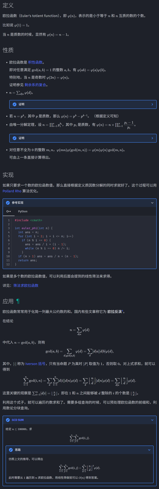


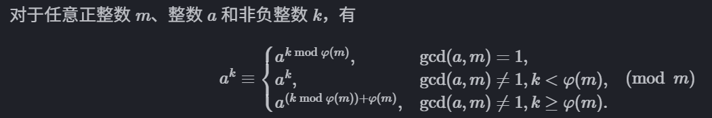

### 数论分块

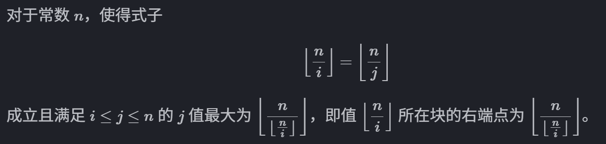

### 中国剩余定理

```cpp
// 此处省略 int gcd(int a, int b) 的实现
void merge(int a1, int m1, int a2, int m2, int &a, int &m){
    a1 %= m1;
    a2 %= m2;
    m = m1 / gcd(m1, m2) * m2;
    if(m2 > m1){
        swap(m1, m2);
        swap(a1, a2);
    }
    for(int t = 0; t < m2; ++t){
        if((a1 + (t * m1) % m2) % m2 == a2){
            a = (a1 + (t * m1) % m) % m;
            return;
        }
    }
}
```

合并复杂度：==很快就是了==.

## 组合数学

### 计数原理与基本计数方法

#### 加法、乘法、减法、除法原理

#### 特殊优先

#### 算两次

#### 隔板法

#### 捆绑与插空法

#### 基础问题

- 分组分配问题
- 染色问题

### 二项式定理与杨辉三角

#### 二项式系数的性质

#### 多项式系数的性质

#### 杨辉三角上组合数的性质

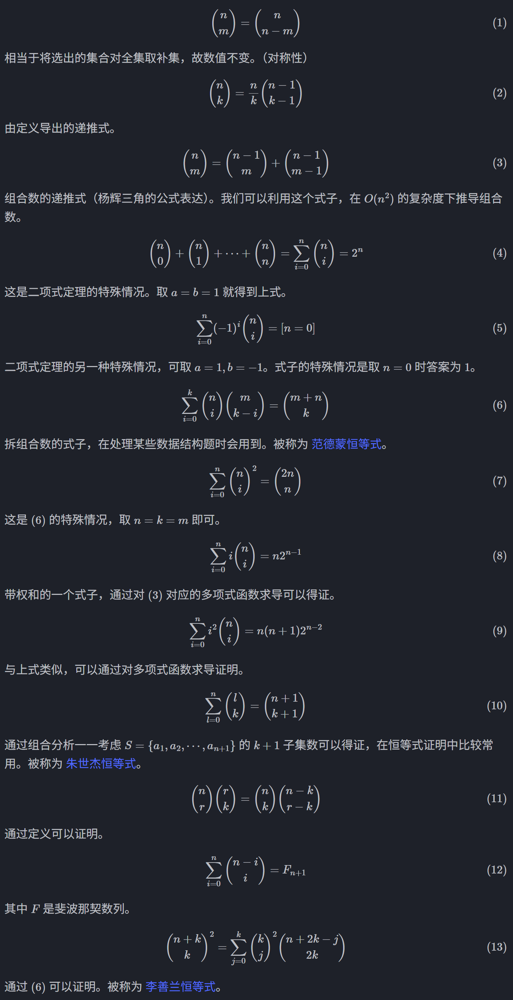

### 多重组合数与可重集的排列数

### 容斥原理与可重集的组合数

### 鸽巢原理

将 $n$ 个物体，划分为 $k$ 组，那么至少存在一个分组，含有大于或等于 $\lceil\frac{n}{k}\rceil$ 个物品.

弱化为覆盖结论不变.

常被用于证明存在性证明和求最坏情况下的解.

### 圆排列

### 错位排列

#### 通项

$$
D_n=n!\sum_{k=0}^n\frac{(-1)^k}{k!}
$$

#### 递推式

$$
D_n=(n-1)(D_{n-2}+D_{n-1})
$$

#### 特殊性质

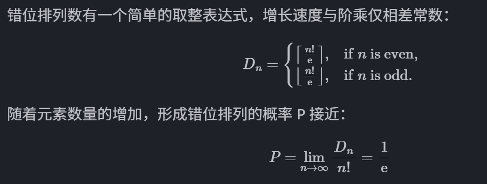

### 斐波那契数列

#### 矩阵快速幂

#### 通项

$$
F_n=\frac{\left(\frac{1+\sqrt5}{2}\right)^n-\left(\frac{1-\sqrt5}{2}\right)^n}{\sqrt5}=\left[\frac{(\frac{1+\sqrt5}{2})^n}{\sqrt5}\right]
$$


#### 快速倍增法

$$
F_{2k}=F_k(2F_{k+1}-F_k)
$$

$$
F_{2k+1}=F_{k+1}^2+F_k^2
$$

```cpp
pair<int, int> fib(int n) {
  if (n == 0) return {0, 1};
  auto p = fib(n >> 1);
  int c = p.first * (2 * p.second - p.first);
  int d = p.first * p.first + p.second * p.second;
  if (n & 1)
    return {d, c + d};
  else
    return {c, d};
}
```

复杂度 $O(\log n)$，常数比矩乘小.

#### 性质

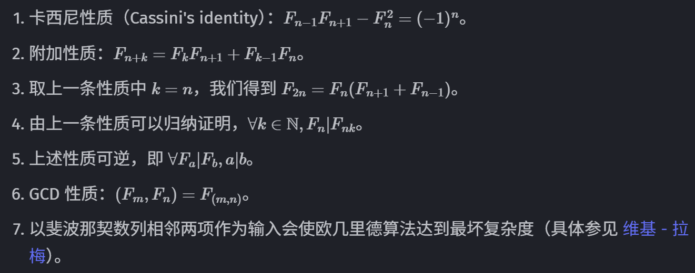

### 卡特兰数

#### 递推式

$$
H_n=\sum_{i=0}^{n-1}H_{i}H_{n-1-i}
$$

$$
H_n=\frac{4n-2}{n+1}H_{n-1}
$$

#### 通项

$$
H_n=\tbinom{2n}{n}-\tbinom{2n}{n-1}=\frac{\tbinom{2n}{n}}{n+1}
$$

#### 路径计数问题与生成函数

### 斯特林数

#### 递推式

$$
{n\brace k}={n-1\brace k-1}+k{n-1\brace k}
$$

$$
{n\brack k}={n-1\brack k-1}+(n-1){n-1\brack k}
$$

#### 通项

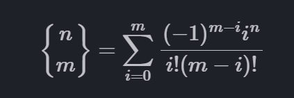

### 卢卡斯定理

如果 $p$ 是素数，则：
$$
\tbinom{n}{k}\equiv\tbinom{\lfloor n/p\rfloor}{\lfloor k/p\rfloor}\tbinom{n\mod p}{k\mod p}\pmod p
$$

```cpp
// 此处省略 int C(int n, int k, int p) 的实现
int Lucas(long long n, long long k, int p)
{
    if (k > n) return 0;
    if (k == 0) return 1;
    return 1ll * C(n % p, k % p, p) * Lucas(n / p, k / p, p) % p;
}
```

复杂度为 $O(f(p)+g(p)\log_pn)$，其中，$f(p)$ 为预处理组合数的复杂度，$g(p)$ 为单次计算组合数的复杂度.

# 基础数据结构

# 基础图论

# 字符串

## KMP 算法

## 扩展 KMP 算法

```cpp
vector<int> z_function(string s) {
  int n = (int)s.length();
  vector<int> z(n);
  for (int i = 1, l = 0, r = 0; i < n; ++i) {
    if (i <= r && z[i - l] < r - i + 1) {
      z[i] = z[i - l];
    } else {
      z[i] = max(0, r - i + 1);
      while (i + z[i] < n && s[z[i]] == s[i + z[i]]) ++z[i];
    }
    if (i + z[i] - 1 > r) l = i, r = i + z[i] - 1;
  }
  return z;
}
```

复杂度 $O(n)$.

## 字符串哈希

大质数：

```
1e8       1e9        1e17               1e18
100000007 1000000007 100000000000001641	1000000000000002319
100000037 1000000009 100000000000001903	1000000000000002481
100000039 1000000021 100000000000001921	1000000000000002493
```

## 马拉车算法

## 最小表示法

```cpp
int k = 0, i = 0, j = 1;
while (k < n && i < n && j < n) {
  if (sec[(i + k) % n] == sec[(j + k) % n]) { // sec 为输入，下标从 0 开始
    k++;
  } else {
    sec[(i + k) % n] > sec[(j + k) % n] ? i = i + k + 1 : j = j + k + 1;
    if (i == j) i++;
    k = 0;
  }
}
i = min(i, j); // 答案
```

复杂度 $O(n)$.

## Lyndon 分解

```cpp
// duval_algorithm
vector<string> duval(string const& s) {
  int n = s.size(), i = 0;
  vector<string> factorization;
  while (i < n) {
    int j = i + 1, k = i;
    while (j < n && s[k] <= s[j]) {
      if (s[k] < s[j])
        k = i;
      else
        k++;
      j++;
    }
    while (i <= k) {
      factorization.push_back(s.substr(i, j - k));
      i += j - k;
    }
  }
  return factorization;
}
```

复杂度 $O(n)$.

# 基础动态规划

## 动态规划的基本模型

下面的题目可以用作动态规划的引入：

- [P2842 纸币问题 1 - 洛谷](https://www.luogu.com.cn/problem/P2842)
- [P2840 纸币问题 2 - 洛谷](https://www.luogu.com.cn/problem/P2840)
- [P2840 纸币问题 2 - 洛谷](https://www.luogu.com.cn/problem/P2840)

严格来说，动态规划作为运筹学的一个分支解决的是多阶段决策的最优化问题；通常来说，动态规划解决的问题还可以是计数等可用递推解决的非最优化问题；实际上，动态规划的“将问题分解成相对简单的子问题求解”的思想使其可以以各种变式广泛地用于解决各种复杂问题.

所谓最优化问题，就是求解使得某一**系统**的某一**属性**达到最值的策略的问题，其中策略是**决策**的序列；所谓多阶段决策的最优化问题，就是决策过程可以划分为若干个**阶段**分别做决策的最优化问题，其中阶段的划分方式不唯一. 所谓状态，就是决策过程中系统可能出现的**状态**，显然，每一阶段都有可能对应许多不同的状态. 此外，能用动态规划解决的多阶段决策的最优化问题还应满足以下性质：

- 最优子结构：这是说，全局最优策略能达到的任一状态所在及往后的所有阶段做的决策，构成在这个状态下的最优策略
- 无后效性：这是说，某一阶段进行决策到达下一阶段的某一状态后，在这个阶段该状态下往后的最优策略不受前一阶段所做决策的影响；也就是说，任一阶段某一状态下往后的最优策略只与当前状态有关
- 最优子结构：这是说，存在策略

# 进阶动态规划

## 矩阵乘法优化

有些线性动态规划 $\{\mathrm{dp}_n\}_N$，我们要求的目标状态 $\mathrm{dp}_N$ 的下标很大，时间上尽管是线性复杂度也不尽人意. 这时候，如果它们的状态转移方程，可以用矩阵运算改写成 $\boldsymbol{\mathrm{dp}_n}=A(n)\cdot\boldsymbol{\mathrm{dp}_{n-1}}$ 的线性形式，加之以矩阵乘法的结合律等性质，我们就可以用矩阵快速幂加速递推，优化成对数级别.

### 线性递推式

当状态转移方程为线性递推式 $\mathrm{dp}_n=\sum_{i=1}^tA_i\mathrm{dp}_{n-i}$，时，可新定义状态向量：
$$
\boldsymbol{\mathrm{dp}_n}=(\mathrm{dp}_{n},\mathrm{dp}_{n-1},\dots,\mathrm{dp}_{n-t+1})^T
$$
进而将方程改写为 $\boldsymbol{\mathrm{dp}_{n}}=A\boldsymbol{\mathrm{dp}_{n-1}}$，其中矩阵 $A$ 构造为：
$$
\left[
\begin{matrix}
A_1 & A_2 & \cdots & A_{t-1} & A_t \\
1   &     &        &         &    \\
    & 1   &        &         &    \\
    &     & \ddots &         &    \\
    &     &        & 1       &    \\
\end{matrix}
\right]
$$
于是，利用矩阵乘法的结合律：
$$
\boldsymbol{\mathrm{dp}_N}=A^N\boldsymbol{\mathrm{dp}_{0}}
$$
所求就是 $(\boldsymbol{\mathrm{dp}_N})_1$.

用矩阵快速幂实现，复杂度 $O(t^3\log N)$​.

### 非线性递推式

若方程有非线性部分，可以通过灵活地拆分成若干个线性部分，或者变换为其他运算形式等方式尝试改写.

广泛地练习可以帮助我们积累经验：

- [Problem - A - Codeforces](https://codeforces.com/gym/106161/problem/A)

### “贡献-最值”形式的方程——广义矩阵乘法优化

矩阵乘法优化线性递推式的关键在于其结合律允许我们进行矩阵快速幂. 我们考察一般定义的的矩阵乘法（广义矩阵乘法）：
$$
(a_{ij})_{ms}(b_{ij})_{sn}=(c_{ij})_{mn}\lrarr c_{ij}=\bigoplus_{k=1}^{s}a_{ik}\otimes b_{kj}
$$
满足结合律的条件：

- $\oplus$ 满足交换律
- $\otimes$ 满足结合律
- $\otimes$ 对 $\oplus$ 满足分配律（同时满足左分配律和右分配律）

由此我们可以用广义矩阵乘法优化更多运算形式满足这些条件的方程.

就比如“贡献-最值”形式的方程（以最大值为例）$\mathrm{dp}_n=\max_{i=1}^{t}\{\mathrm{dp}_{n-i}+A_{i}\}$ 就可以直接运用矩阵快速幂. 我们只需要将矩阵定义中的 $\otimes$ 运算定义为加法，$\oplus$ 定义为取最大值，然后像上文那样构造矩阵，有时候，“广义矩阵乘法”也特指这种定义.

然而实际问题中 $A_i$ 往往并不是常量，往往是 $n-i$ 的函数，即状态转移方程的形式是：
$$
\mathrm{dp}_n=\max_{i=1}^{t}\{\mathrm{dp}_{n-i}+B_{n-i}\}
$$

这时候我们构造的矩阵 $A(n)$ 也是随 $n$ 变化的，不好直接快速幂.

不要忘记我们要优化的是所求的 $N$ 很大时的情形，要灵活利用其他规模比较小的信息，比如说，$\{B_i\}_N$ 跳跃点的数量是不是比较少？如果是的话，我们构造的矩阵序列 $\{A(n)\}_N$ 变化点也比较少，就可以分段地使用矩阵快速幂.

具体地说，如果 $B_i=C_{\varphi(i)}$，其中 $\{C_i\}_k$ 是相邻不等的项数较少的数列且 $\varphi(i)$ 定义为：
$$
\varphi(i)=j|p_{j-1}<i\leq p_j
$$
其中 $\{p_i\}_k$ 是正项数列 $\{s_i\}_k$ 的前缀和.

那么，就可以新定义状态向量：
$$
\boldsymbol{\mathrm{dp}_n}=(\mathrm{dp}_{n},\mathrm{dp}_{n-1},\dots,\mathrm{dp}_{n-t+1})^T
$$
并构造矩阵：
$$
A(n+1)=
\left[
\begin{matrix}
B_{n}  & B_{n-1} & \cdots & B_{n-t+2} & B_{n-t+1} \\
0      &         &        &           &    \\
       & 0       &        &           &    \\
       &         & \ddots &           &    \\
       &         &        & 0         &    \\
\end{matrix}
\right]
=
\left[
\begin{matrix}
C_{\varphi(n)}  & C_{\varphi(n-1)} & \cdots & C_{\varphi(n-t+2)} & C_{\varphi(n-t+1)} \\
0    &         &        &           &    \\
     & 0       &        &           &    \\
     &         & \ddots &           &    \\
     &         &        & 0         &    \\
\end{matrix}
\right]
$$
其中空白处的默认值为 $-\infty$，并使用广义的矩阵乘法定义.

则有：
$$
\boldsymbol{\mathrm{dp}_n}=A(n)\boldsymbol{\mathrm{dp}_{n-1}}=\left(\prod_{i=n}^{t+1}A(i)\right)\boldsymbol{\mathrm{dp}_t}
$$
下面着重讨论乘式 $\prod_{i=n}^{t+1}A(i)$.

依据 $\varphi(i-t)$ 对 $\{A(i)|i\in\Z,t+1\leq i\leq n\}$ 作划分，记 $F(j)=\{A(i)|\varphi(i-t)=j\}$，显然有下面的结论：

- $F(j)$ 中的元素在乘式中是连续的，记这部分为 $E(j)$

- 当 $j<\varphi(n-t)$ 时，有 $|F(j)|=s_j$

- 将 $F(j)$ 中的元素按 $i$ 排序，至少有前 $m(j)=\max\{s_j-t+1,0\}$ 个元素是相同的，且它们都为：
  $$
  M(j)=
  \left[
  \begin{matrix}
  C_{j}  & C_{j} & \cdots & C_{j} & C_{j} \\
  0      &         &        &           &    \\
         & 0       &        &           &    \\
         &         & \ddots &           &    \\
         &         &        & 0         &    \\
  \end{matrix}
  \right]
  $$

所以：
$$
\begin{align}
\prod_{i=n}^{t+1}A(i)&=\prod_{j=k}^{1}E(j)\\
&=\prod_{j=k}^{1}\left(\prod_{r=\min\{p_j,n-t\}}^{p_{j-1}+1+m(j)}A(r+t)\right)M(j)^{m(j)}
\end{align}
$$

也就是分 $k$ 段运用矩阵快速幂，复杂度 $O(k(St^3+t^4))$，其中 $S$ 为计算 $s_j$ 的复杂度，往往是常数，于是也可以认为复杂度是 $O(kt^4)$.

下面的题目可以用作练习：

- [P1052 [NOIP 2005 提高组] 过河 - 洛谷](https://www.luogu.com.cn/problem/P1052)

## 斜率优化

# 进阶图论

## k 短路

# 进阶数据结构

# 计算几何

## 扫描线

## 旋转卡壳

# 进阶数学

## 多项式

### FFT

```cpp
// 此处省略 struct Com 的实现
int lim = 1, len, rev[M];
void fft(Com *a, int opt){
	Com wn, w;
	Com u, t;
	int m;
	
	for(int i = 0; i < lim; ++i){
		if(i < rev[i]){
			swap(a[i], a[rev[i]]);
		}
	}
	
	for(int dep = 1; dep <= len; ++dep){
		m = 1 << dep;
		wn = com(cos(2 * pi / m), opt * sin(2 * pi / m));
		for(int k = 0; k < lim; k += m){
			w = com(1, 0);
			for(int j = 0; j < m >> 1; ++j){
				u = a[k + j];
				t = w * a[k + j + m / 2];
				a[k + j] = u + t;
				a[k + j + m / 2] = u - t;
				w = w * wn;
			}
		}
	}
	
	if(opt == -1){
		for(int i = 0; i < lim; ++i){
			a[i].r /= lim;
		}
	}
}
bool init = [](){
    while(lim <= n + m){ // 这里的 n + m 是运算过程中多项式的可能的最大项数
		lim <<= 1;
		++len;
	}
	for(int i = 0; i < lim; ++i) rev[i] = (rev[i >> 1] >> 1) | ((i & 1) << (len - 1));
}();
```

## 线性代数

### 线性基

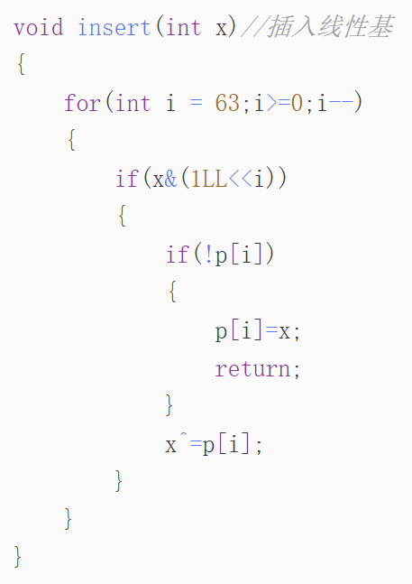

## 线性规划

# 博弈论

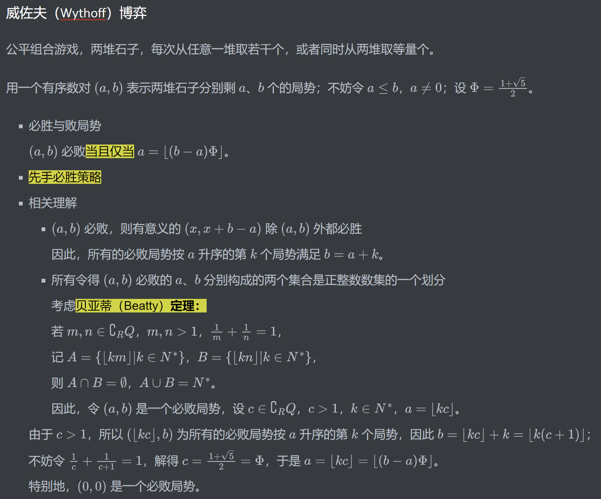

# 杂项

